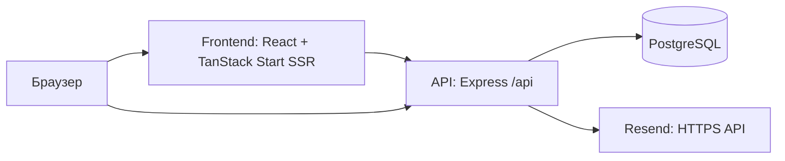

<!-- Hallmark · pre-emit critique: P4 H5 E4 S5 R5 V4. Read-only audit; no redesign. -->

# Linqo: чеклист первого production

Дата: **27 октября 2026**. Проверена текущая рабочая копия, включая незакоммиченные изменения.

## Решение

**Сейчас — не выпускать с открытой регистрацией и неограниченными пользовательскими публикациями.** Продукт уже имеет рабочую основу, а не только интерфейс: редактор, публикация в PostgreSQL, серверная валидация, сессии, подтверждение email, ограничения запросов и загрузок. Но сборка, прошедшая тесты, ещё не означает готовность публичного сервиса.

Ближайшая достижимая цель — **закрытая beta на бесплатной инфраструктуре**, после исправления потери черновиков, настройки реального входа/почты и проверки деплоя. Уязвимости зависимостей закрыты 27 октября; остальные блокеры ниже остаются актуальными. Аналитику, пользовательские домены и новую дизайн-систему для этого делать не требуется.

Обозначения: **P0** — закрыть до любого публичного выпуска; **P1** — закрыть до открытой регистрации/публикаций; **P2** — следующий этап качества и эксплуатации. Незакрытый пункт конфигурации не обязательно означает ошибку в коде.

## Что действительно проверено

| Проверка | Результат |
|---|---|
| `npx tsc --noEmit` | Проходит |
| `npm run build` | Проходит; создаёт Vercel SSR/functions + static assets |
| `npm run check:build` | Собранный SSR: `/`, `/login`, `/verify-email` — HTTP 200, HTML с содержимым Linqo |
| `npm run test:auth` | 14/14 |
| `npm run test:abuse` | 5/5 |
| `npm run test:safety` | 19/19 |
| `npm run test:tour` | 5/5 |
| Всего автоматизированных тестов | **43/43** |
| `npx eslint src backend scripts tests` | 0 ошибок, 7 предупреждений Fast Refresh |
| `npm run lint` из корня | Остановлен после продолжительного обхода; конфиг не исключает `.vercel` и другие генерируемые каталоги. Для оценки исходников использована команда выше |
| `npm audit` / `npm audit --omit=dev` | **0 уязвимостей**, включая инструменты разработки |
| `bun audit` | **0 уязвимостей**; frozen lockfile проверен Bun 1.3.11 |
| `npm ls --depth=0 --omit=optional` | Проходит, конфликтов установленных зависимостей не обнаружено |
| Проверка frontend-артефакта на локальные server secrets | В 51 текстовом static-файле не найдены значения заполненных `RESEND_API_KEY`, `GOOGLE_CLIENT_SECRET`, `DATABASE_URL`; значения не выводились |
| Главная, Publish, Settings/Security | Проверены ширины 320 / 375 / 414 / 768 px: горизонтального переполнения документа не обнаружено |

До обновления npm audit показывал 18 записей для production-зависимостей (7 critical, 9 high, 2 moderate), а полный аудит — 22 (9 critical, 11 high, 2 moderate). Это записи пакетов, включая транзитивные зависимости, а не независимо воспроизведённые атаки. После обновления оба аудита показывают 0. Эксплуатация уязвимостей не проводилась.

Публичные страницы просмотрены на работающем `localhost:8080`. Авторизованные экраны проверены с настоящими компонентами приложения в изолированном браузерном стенде с тестовыми API-ответами. На нём запрещены серверные изменения. Это позволило пройти интерфейс и воспроизвести потерю черновика без создания аккаунтов и изменения твоей БД.

**Не проверено:** настоящий production-хостинг/Linux, доставка письма во входящие, полный OAuth round trip, реальная публикация через размещённый API, восстановление production-БД из backup, нагрузка и реальные мобильные Safari/Chrome. На момент обхода в локальной БД не было опубликованного профиля для проверки успешного публичного SSR на живых данных.

## Блокеры и приоритеты

### P0 — зависимости

- [x] **Обновить уязвимые зависимости согласованным набором версий, затем повторить проверки.** Установлены `@tanstack/react-start 1.169.4`, `@tanstack/start-server-core 1.169.45`, `seroval 1.7.2`, `proxy-addr 2.0.8`, `body-parser 2.4.0`, `multer 2.5.0`, `zod 4.6.7`, `vite 8.1.6`. Обновлены и согласованы `package-lock.json` и `bun.lock`; известные уязвимости npm/Bun отсутствуют. [TanStack advisory](https://github.com/advisories/GHSA-qx66-fv34-fjm8), [proxy-addr advisory](https://github.com/advisories/GHSA-jqcg-44mw-7w3h).
- [x] Проверить major-переход Zod и совместимость Lovable/TanStack/Nitro без `npm audit fix --force`. TypeScript, 43 теста, сборка и запросы к собранному SSR проходят. Тип параметров error component приведён к актуальному `ErrorComponentProps`. Vite ограничен совместимой веткой `~8.1.6`: проверка запуска SSR обязательна при дальнейшем обновлении сборщика, успешной компиляции недостаточно.

`npm run check:build` проверяет Vercel-артефакт напрямую после сборки. Обычный `vite preview` в текущей связке TanStack/Nitro ищет `dist/server/server.js`, которого Vercel preset не создаёт, и возвращает 500. Этот локальный preview требует отдельной настройки; проверка самого SSR-артефакта проходит. Запуск на реальном хостинге остаётся отдельным пунктом деплоя.

### P1 — данные пользователя

- [ ] **Исправить восстановление черновика.** В builder сначала загружается localStorage, затем опубликованная серверная версия безусловно выполняет `setProfile(mine.profile)`. Воспроизведено: изменить название блока → обновить страницу → вместо изменения появляется текст последней публикации. Нужны версия/время черновика и выбор корректного состояния при конфликте. [Перезапись](C:/Users/lomak/OneDrive/Documents/ProgrammingProjects/WebProjects/link-hub/src/routes/build.tsx:145).
- [ ] **Разделить черновики по аккаунтам.** Сейчас ключ один — `linqo_profile_v2`, а выход не очищает его. Новый аккаунт без своей публикации может получить черновик предыдущего пользователя на этом устройстве. Публикуемые данные при этом всё равно защищены серверной проверкой владельца. [Ключ](C:/Users/lomak/OneDrive/Documents/ProgrammingProjects/WebProjects/link-hub/src/lib/link-store.ts:1365), [сохранение](C:/Users/lomak/OneDrive/Documents/ProgrammingProjects/WebProjects/link-hub/src/lib/link-store.ts:1426), [выход](C:/Users/lomak/OneDrive/Documents/ProgrammingProjects/WebProjects/link-hub/src/lib/auth-context.tsx:50).
- [ ] **Обработать недоступность API при открытии builder.** `getMyProfile()` может отклонить promise; в эффекте нет `catch/finally`, поэтому `ownedProfileChecked` может навсегда остаться false и экран будет крутить загрузку. HTTP-ошибки также превращаются в «профиля нет». Показать повтор запроса/ошибку, сохранив локальный черновик. [Клиент](C:/Users/lomak/OneDrive/Documents/ProgrammingProjects/WebProjects/link-hub/src/lib/publish.ts:67), [эффект](C:/Users/lomak/OneDrive/Documents/ProgrammingProjects/WebProjects/link-hub/src/routes/build.tsx:142).
- [ ] **Определить снятие публикации и удаление данных.** DELETE аккаунта удаляет пользователя, но FK `ON DELETE SET NULL` сохраняют страницы и файлы публичными и без владельца. UI честно предупреждает об этом; это не скрытое поведение. Однако пользователь теряет возможность снять страницу, а повторная регистрация получает новые аккаунтные квоты при сохранении старого контента. Нужны согласованная политика удаления/снятия страницы и минимальный рабочий способ модераторского удаления. Полная админка для первой версии необязательна. [DELETE](C:/Users/lomak/OneDrive/Documents/ProgrammingProjects/WebProjects/link-hub/backend/routes/me.ts:146), [FK](C:/Users/lomak/OneDrive/Documents/ProgrammingProjects/WebProjects/link-hub/backend/db.ts:56), [предупреждение UI](C:/Users/lomak/OneDrive/Documents/ProgrammingProjects/WebProjects/link-hub/src/components/settings/SettingsContent.tsx:382).
- [ ] **Проверить backup → restore на отдельной БД.** В backup должны попасть не только страницы, но и медиа, аккаунты, OAuth-связи и служебные таблицы. Тест восстановления не выполнен; внешний backup/PITR неизвестен. Сами скрипты/процедуры восстановления в репозитории не найдены.

### P1 — вход и конфигурация реального окружения

- [ ] **Проверить реальную доставку email.** На момент аудита `RESEND_API_KEY` уже заполнен; его значение не выводилось и не проверялось отправкой. `RESEND_FROM` остаётся тестовым `resend.dev`. В production код его отклоняет; для общей регистрации нужен отправитель с подтверждённого домена. Проверить регистрацию, повторную отправку, истёкшую/повторную ссылку, смену email и восстановление пароля на реальных почтовых ящиках. В коде эти сценарии реализованы, но отправка во входящие в этом аудите не доказана. [Email](C:/Users/lomak/OneDrive/Documents/ProgrammingProjects/WebProjects/link-hub/backend/email.ts:13), [ограничения Resend](https://resend.com/docs/knowledge-base/403-error-resend-dev-domain).
- [ ] **Настроить GitHub OAuth.** Локальная конфигурация Google заполнена, GitHub — нет. Наличие кнопки GitHub не означает готовый способ входа. Для обоих провайдеров зарегистрировать production callback URL и пройти первый/повторный вход на размещённом сайте. [OAuth](C:/Users/lomak/OneDrive/Documents/ProgrammingProjects/WebProjects/link-hub/backend/oauth.ts:24).
- [ ] **Развернуть Express API и PostgreSQL отдельно от frontend-сборки.** `npm run build` не запускает и не разворачивает `backend/index.ts`; Vercel-конфиг не содержит проксирования `/api`. [Скрипты](C:/Users/lomak/OneDrive/Documents/ProgrammingProjects/WebProjects/link-hub/package.json:6), [конфиг](C:/Users/lomak/OneDrive/Documents/ProgrammingProjects/WebProjects/link-hub/vercel.json:1).
- [ ] **Собрать frontend с настоящим `VITE_API_URL`.** Текущая локальная production-сборка указывает на `http://localhost:3001`. У посетителя это его собственный компьютер. Значение встраивается при сборке; изменение только runtime env не исправит JS. [Клиент](C:/Users/lomak/OneDrive/Documents/ProgrammingProjects/WebProjects/link-hub/src/lib/auth-client.ts:4), [Vite](https://vite.dev/guide/env-and-mode.html).
- [ ] **Проверить cookies и топологию доменов.** Сессии и proof-cookie регистрации используют `SameSite=Lax`. Прямая связка `*.vercel.app` → `*.onrender.com` является cross-site и ломает cookie-запросы. Нужны same-origin proxy или HTTPS-поддомены одного собственного сайта. Простая замена на `SameSite=None` не гарантирует работу там, где браузер блокирует third-party cookies. [Cookie](C:/Users/lomak/OneDrive/Documents/ProgrammingProjects/WebProjects/link-hub/backend/auth.ts:22), [регистрация](C:/Users/lomak/OneDrive/Documents/ProgrammingProjects/WebProjects/link-hub/backend/registration.ts:28), [MDN](https://developer.mozilla.org/en-US/docs/Web/HTTP/Reference/Headers/Set-Cookie).
- [ ] **Установить production env и доверенные proxy.** HTTPS, `NODE_ENV=production`, точный CORS origin, публичные URL callback/файлов, проверенный TLS к БД. `TRUSTED_PROXIES` задавать по реальной инфраструктуре, не `true`/`0.0.0.0/0`. Иначе лимиты могут объединять всех посетителей по адресу proxy или доверять поддельному адресу клиента.

### P1 для открытых загрузок — медиа и стоимость хранения

- [ ] **Ограничить накопленный объём на аккаунт и удалить сиротские файлы.** Сейчас есть 128 MiB загрузок/сутки/аккаунт, но нет общей квоты на хранимые файлы, замены с удалением старой версии или сборщика неопубликованных загрузок. Существуют вставки медиа для ещё не созданного slug. Для бесплатной БД это существенный риск заполнения. [Квоты](C:/Users/lomak/OneDrive/Documents/ProgrammingProjects/WebProjects/link-hub/backend/abuse.ts:16), [INSERT файлов](C:/Users/lomak/OneDrive/Documents/ProgrammingProjects/WebProjects/link-hub/backend/routes/music.ts:43).
- [ ] **Ограничить параллельную загрузку и дорогую обработку.** Multer полностью буферизует файл до проверки байтовой квоты. 30 параллельных файлов по 20 MiB — около 600 MiB только буферов; это оценка по лимитам, не проведённый нагрузочный тест. Нужны меньшая параллельность/лимиты на edge либо потоковая обработка. [Memory storage](C:/Users/lomak/OneDrive/Documents/ProgrammingProjects/WebProjects/link-hub/backend/content-security.ts:32).
- [ ] **Выбрать реальный режим проверки содержания медиа.** Техническая безопасность формата работает, изображения декодируются и перекодируются. Но media inspector по умолчанию возвращает `unreviewed`, и это допускается к публичной выдаче; внешние URL не проходят CV-проверку. Не считать это защитой от нежелательных изображений. До подключения твоей модели возможны закрытая beta, ограниченные загрузки либо ручное одобрение с недоступностью файла до проверки. [Inspector](C:/Users/lomak/OneDrive/Documents/ProgrammingProjects/WebProjects/link-hub/backend/content-inspection.ts:9), [публичная выдача](C:/Users/lomak/OneDrive/Documents/ProgrammingProjects/WebProjects/link-hub/backend/routes/images.ts:39).

## Карта проекта: что и куда деплоить



Это логическая карта. Для бесплатной схемы ниже браузер обращается к API через тот же frontend-origin, а не напрямую к другому сайту.

| Часть | Где находится | За что отвечает |
|---|---|---|
| Маршруты frontend | `src/routes/` | Главная, auth, welcome/onboarding, builder, settings, preview, `/p/$slug` |
| Серверный рендер | `src/server.ts`, `src/start.ts` | SSR, CSP/security headers, обработка ошибок документа |
| Редактор | `src/routes/build.tsx`, `src/components/*-hub`, `block-*` | Состояние профиля, 6 вкладок, live preview, блоки, шаблоны, эффекты |
| Данные/валидация frontend | `src/lib/` | Модель Profile, localStorage, HTTP-клиенты, общие ограничения |
| API | `backend/index.ts`, `backend/routes/` | Сессии, аккаунты, публикации, загрузка/выдача медиа |
| БД и ограничения | `backend/db.ts`, `*-schema.ts`, `publication-limits.ts`, `abuse.ts` | Таблицы, стартовые изменения схемы, SQL-квоты и транзакции |
| Статические материалы | `public/` | Встроенная музыка и иллюстрации; суммарно около 45.9 MB, это не размер первоначальной загрузки страницы |
| Авторские инструменты | `scripts/music-gen/` | Python-генерация музыки; для runtime сайта Python не нужен |

### Как сохраняются данные

1. Изменение в редакторе → состояние React → один ключ localStorage. **Серверного автосохранения неопубликованного черновика нет.**
2. Publish → серверная проверка и обработка → профиль JSONB в PostgreSQL.
3. Пользовательские изображения/аудио → BYTEA в PostgreSQL; часть изображений может оставаться встроенной в JSON профиля после очистки.
4. Публичный `/p/$slug` → SSR-loader → API → профиль из PostgreSQL.
5. Сессии, OAuth-связи, токены подтверждения/сброса и общие счётчики ограничений также находятся в PostgreSQL.

Поэтому Redis и постоянная папка upload для текущей версии не обязательны. Зато размер БД, её backup и пропускная способность важны: музыка хранится не в бесплатной папке frontend-хостинга.

## Бесплатный первый деплой

**Предлагаемая цель для закрытой beta: Vercel Hobby + Render Free API + Neon Free PostgreSQL. Это ещё не настроенный деплой и не обещание постоянной бесплатной доступности.**

| Компонент | Вариант | Что учитывать |
|---|---|---|
| SSR/frontend | Vercel Hobby | Текущий preset подходит. Hobby разрешает личное некоммерческое использование; соответствие твоего запуска этим условиям нужно оценить перед выбором. [Условия](https://vercel.com/docs/plans/hobby) |
| Express API | Render Free web service | Засыпает после 15 минут простоя, пробуждение около минуты; 750 instance-hours/месяц на workspace. Render прямо не рекомендует Free для production. Это компромисс beta с редкими посетителями. [Лимиты](https://render.com/docs/free) |
| PostgreSQL | Neon Free | На дату проверки: 1 GB на проект и 100 CU-hours/месяц. Этого достаточно для небольшой тестовой БД, но десятки максимальных аудиофайлов уже существенны. Лимиты и backup-возможности проверить при создании проекта. [Тариф](https://neon.com/pricing) |
| Email | Уже выбранный Resend | HTTPS-транспорт подходит для API. Для писем произвольным пользователям нужен подтверждённый домен; бесплатный адрес frontend-хостинга этого не заменяет. Тестовый sender ограничен своим Resend email |

**Не использовать Render Free Postgres как постоянную БД:** она истекает через 30 дней. Пользовательские файлы при нынешней архитектуре переживают рестарт API, поскольку лежат во внешней PostgreSQL, а не на диске Render. Лимиты Render приведены из [официального описания](https://render.com/docs/free).

### Что изменить для бесплатных адресов провайдеров

```text
Браузер → https://<frontend>.vercel.app
                    /api/* → внешний rewrite → Render Express
                                                    ├─ Neon PostgreSQL
                                                    └─ Resend HTTPS
```

- [ ] Добавить внешний rewrite `/api/:path*` до frontend catch-all и проверить, что итоговый Nitro/Vercel output его сохраняет. В репозитории такого правила сейчас нет. [Vercel external rewrites](https://vercel.com/docs/routing/rewrites).
- [ ] Для этой схемы задать `VITE_API_URL` равным origin frontend, **без `/api` на конце**: клиенты уже добавляют `/api/...`.
- [ ] Публичные `FRONTEND_URL` и `API_BASE_URL` тогда указывают на frontend-origin. OAuth callback и абсолютные URL загруженных файлов проходят через `/api` proxy. При прямой схеме поддоменов `API_BASE_URL` указывает на API-origin. Эта согласованность важна и для проверки принадлежности медиа на сервере.
- [ ] На staging проверить передачу `Set-Cookie`, Cookie, Origin, адреса клиента и загрузки 10/20 MiB через rewrite. Не подменять внешний rewrite собственной Vercel Function без оценки лимита: у функций payload ограничен 4.5 MB. Это ограничение функции, а не доказанный лимит любого external rewrite. [Functions limit](https://vercel.com/docs/functions/limitations).
- [ ] Проверить первый вход/публичный SSR после сна Render. Сейчас ошибки API могут превращаться в «страница не опубликована», поэтому перед beta нужен нормальный статус недоступности и повтор запроса.

Если важны постоянная доступность и быстрый первый запрос, бесплатный спящий API этим требованиям не соответствует. Переход на постоянно работающий API/свой VPS можно сделать позже; выбирать стабильный публичный адрес медиа лучше заранее, так как URL сохраняются в профилях.

### Переменные окружения

| Где | Переменная | Назначение |
|---|---|---|
| Сборка frontend | `VITE_API_URL` | Публичный origin, через который доступны API и медиа; не секрет |
| API | `NODE_ENV=production` | Включает Secure cookie и production-проверки конфигурации |
| API | `PORT` | Порт, выданный хостингом |
| API | `DATABASE_URL` | Отдельная production-БД с подходящим TLS; не localhost |
| API | `FRONTEND_URL` | Публичный HTTPS origin интерфейса/ссылок в письмах |
| API | `API_BASE_URL` | Публичный API origin для OAuth callback и проверки media URL |
| API | `CORS_ORIGIN` | Точный frontend-origin |
| API | `RESEND_API_KEY`, `RESEND_FROM` | Реальная отправка с подтверждённого домена |
| API | `GOOGLE_CLIENT_ID`, `GOOGLE_CLIENT_SECRET` | Google OAuth production app |
| API | `GITHUB_CLIENT_ID`, `GITHUB_CLIENT_SECRET` | GitHub OAuth production app |
| API | `TRUSTED_PROXIES` | Проверенные IP/CIDR reverse proxy |
| API | `ABUSE_SECRET` | Необязательный стабильный секрет 32+ символов; без него код сохраняет общий секрет в БД |

Ключи и пароли не должны иметь префикс `VITE_`, попадать в Git или frontend bundle.

### Команды и старт

Текущий frontend уже собирается через `npm run build`; на Vercel сервер запускает платформа. `npm run dev` и `npm run preview` не являются production-стартом всего продукта.

Для отдельного Node API после `npm ci --include=dev --include=optional` возможен запуск:

```sh
node --import tsx backend/index.ts
```

Окружение передаёт хостинг, включая `NODE_ENV=production`. `tsx` сейчас в devDependencies, поэтому `npm ci --omit=dev` без отдельной компиляции API лишит эту команду launcher. До выпуска лучше добавить явный API start/build script и закрепить версию Node; текущий frontend-артефакт использует Node 24. Устанавливать `sharp`/optional native dependencies на целевом Linux, не копировать Windows `node_modules`.

База должна существовать до запуска API. Он ждёт `initDb()` и только потом начинает слушать порт. На старте выполняются `CREATE EXTENSION`, `CREATE TABLE`, `ALTER TABLE` и индексы: проверить права пользователя БД и первый старт одной инстанции. Версионированного migration runner нет; для первого небольшого запуска это можно контролировать процедурой, для следующих изменений нужен план миграций/отката.

## Обход страниц и интерфейса

| Экран | Результат обхода | Что осталось |
|---|---|---|
| `/` | Реальный браузер + HTTP 200, темы и разделы отображаются, 4 ширины без горизонтального overflow | Текст «Four tabs» устарел: в builder 6 вкладок |
| `/login` | Вход/регистрация и Google/GitHub видны; пустые поля дают ошибки с фокусом | Настоящие Google/GitHub/email round trips на staging |
| `/reset-password` | Начальный экран просмотрен; код, попытки и сброс проверены API-тестами | Реальный email, ввод кода и вход с новым паролем на хостинге |
| `/verify-email` | Недействительный token не подтверждается автоматически, фрагмент убирается из URL; API-тесты проверяют replay/expiry | Реальная ссылка из доставленного письма |
| `/welcome`, `/onboarding` | Изолированный UI: welcome → первый вопрос → выбор цели → второй вопрос | Запись ответов и возврат после реального нового входа |
| `/build` | Пройдены Content, Templates, Appearance, Atmosphere, Identity, Publish; начало тура 1/9 → 2/9 → Skip; Publish проверен на 4 ширинах | Потеря draft воспроизведена; публикация/загрузки на реальном staging |
| `/settings` | Изолированный UI: Account и Security, 4 ширины | Настоящая смена email/пароля и согласованный lifecycle удаления |
| `/preview` | Изолированный UI читает черновик и показывает Private draft preview | Реальный переход в другую вкладку и обновление черновика |
| `/p/$slug` | Валидный профиль отображается в изолированном UI | У отсутствующего профиля реальный сервер отдаёт **200**, не 404; успешный публичный SSR на размещённых данных ещё не проверен |
| Неизвестный маршрут | Реальный HTTP 404 | Обычная 404 работает |
| `robots.txt`, `sitemap.xml` | Реальный HTTP 404 | Добавить перед продвижением/индексацией |

### Визуальная часть / Hallmark

Paper & Ink, Fraunces и DM Sans дают достаточно цельный интерфейс; новый полный редизайн не является условием выпуска. Декоративные предпочтения не приравниваются к проблемам безопасности.

- **Major / input accessibility:** в Content есть кнопки удаления социальных ссылок без доступного имени; часть полей опирается на визуальный label без явной связи. Добавить `aria-label`, `id/htmlFor`, проверить Tab/клавиатуру и screen reader. [Кнопка](C:/Users/lomak/OneDrive/Documents/ProgrammingProjects/WebProjects/link-hub/src/components/BlockEditor.tsx:644).
- **Minor / honest copy:** главная обещает четыре вкладки вместо шести. [Текст](C:/Users/lomak/OneDrive/Documents/ProgrammingProjects/WebProjects/link-hub/src/routes/index.tsx:288).
- **Minor / honest copy:** уведомление «one cookie / no third parties» не описывает временные registration/OAuth cookies и внешние сервисы/шрифты. Скорректировать объяснение данных и дать понятный контакт/страницу с правилами сервиса. Это аудит фактического текста, не юридическое заключение. [Уведомление](C:/Users/lomak/OneDrive/Documents/ProgrammingProjects/WebProjects/link-hub/src/components/CookieConsent.tsx:43).

Итого визуальной части: **0 critical · 1 major · 2 minor**. Полная проверка контраста и assistive technology не проводилась.

## P2 — улучшения после обязательных исправлений

- [ ] `getPublishedProfile()` должен различать 404, сетевую ошибку и 5xx. Сейчас всё превращается в null и обычный документ 200. Для неизвестного профиля — 404, для недоступного API — нормальная ошибка/503. [Публичный маршрут](C:/Users/lomak/OneDrive/Documents/ProgrammingProjects/WebProjects/link-hub/src/routes/p.$slug.tsx:48), [fetch](C:/Users/lomak/OneDrive/Documents/ProgrammingProjects/WebProjects/link-hub/src/lib/publish.ts:101).
- [ ] Проверить настоящие OG/Twitter preview, canonical/og:url и индексацию. UI social preview подставляет аватар, а публичные OG-теги используют только `ogImage`; предварительный вид не гарантирует такой же результат у crawler. `APP_DOMAIN` пока жёстко равен `linqo.app`. Для `/build`, `/settings`, `/welcome`, `/onboarding`, auth-страниц определить noindex. [Домен](C:/Users/lomak/OneDrive/Documents/ProgrammingProjects/WebProjects/link-hub/src/lib/constants.ts:4).
- [ ] Добавить readiness к БД: `/api/health` сейчас всегда отвечает `{ok:true}` и не проверяет доступность PostgreSQL. Плюс uptime/error monitoring без секретов в логах. [Health](C:/Users/lomak/OneDrive/Documents/ProgrammingProjects/WebProjects/link-hub/backend/index.ts:58).
- [ ] Добавить graceful shutdown HTTP + pool, разумные таймауты HTTP/БД и уборку истёкших сессий/reset-токенов. Для маленького старта достаточно явной процедуры; полноценная очередь писем/webhooks могут быть следующим этапом.
- [ ] Аудио отдаётся целым BYTEA без Range, квота скачивания проверяется после чтения файла. Проверить seek/повторное воспроизведение и расход памяти/трафика; для роста перейти к потоковой/объектной выдаче. [Аудио](C:/Users/lomak/OneDrive/Documents/ProgrammingProjects/WebProjects/link-hub/backend/routes/music.ts:49).
- [ ] Добавить CI: typecheck, source lint, 43 теста, build, audit и проверку первого старта БД. Сейчас единственный workflow публикует DevLog. Исключить generated folders из корневого lint и закрепить сторонний action commit вместо `@main`. [Workflow](C:/Users/lomak/OneDrive/Documents/ProgrammingProjects/WebProjects/link-hub/.github/workflows/devlog.yml:17).
- [ ] Разобрать hydration warning темы/nonce, наблюдаемый в dev-браузере. Подтверждён warning, не подтверждено падение production. Проверить production SSR отдельно, не ослабляя CSP. [Root shell](C:/Users/lomak/OneDrive/Documents/ProgrammingProjects/WebProjects/link-hub/src/routes/__root.tsx:112).
- [ ] Обработать ошибки localStorage/переполнение квоты. `saveProfile()` пишет без try/catch на каждое изменение; при большом draft ошибка не превращается в понятное уведомление. Облегчить initial splash на auth/повторных визитах по итогам реального замера, не считать анимацию сетевой загрузкой.

`AnalyticsCard` и `DomainCard` найдены в репозитории, но в текущем PublishHub не подключены. Реальных analytics/custom domain/waitlist нет; это **не обязательные функции первого выпуска**. Не рекламировать их как работающие.

## Финальный приёмочный чеклист на staging

Это оставшиеся проверки, не утверждение, что они уже выполнены.

- [ ] Свежая Linux-установка из lockfile; build/typecheck/tests/source lint проходят; ни в одном клиентском bundle нет localhost API и секретов.
- [ ] Первый запуск на пустой отдельной PostgreSQL создаёт схему; повторный старт не теряет данные.
- [ ] Регистрация email → фактически доставленное письмо → одно подтверждение → вход. До подтверждения protected API закрыт.
- [ ] Повторная/истёкшая ссылка и resend показывают корректный результат; настройка почты не имитируется UI.
- [ ] Google и GitHub: первый вход, повторный вход, выход, refresh сессии. Cookies работают и в мобильном браузере, и в приватном режиме.
- [ ] Создать два разных аккаунта: черновики и страницы не смешиваются; чужую страницу/API-ресурс изменить нельзя.
- [ ] Изменить опубликованную страницу без Publish → refresh → правки сохраняются после исправления draft-конфликта.
- [ ] Добавить каждый из 14 типов блока; переупорядочить, удалить, сменить шаблон, проверить оба preview.
- [ ] Загрузить аватар/cover/gallery/OG/audio, сменить username после загрузки, опубликовать; проверить привязку файлов к slug и сохранность старых/новых ссылок.
- [ ] Пограничные 10 MiB image / 20 MiB audio и превышение лимита проходят через выбранный proxy с понятной ошибкой, без OOM и 4.5 MB function-подмены.
- [ ] Опубликовать → открыть `/p/slug` в отдельном браузере без авторизации; проверить картинки, музыку после пользовательского действия, видео, ссылки, QR, OG-теги в HTML.
- [ ] Перезапустить API и выполнить redeploy frontend — опубликованные данные/файлы остаются доступны.
- [ ] Смена пароля/email, восстановление доступа и инвалидирование старых сессий работают на реальном API.
- [ ] Удаление/снятие страницы ведёт к согласованному результату для публичного URL, файлов и занятого username.
- [ ] Backup восстановлен в отдельную БД; известна последовательность отката версии приложения и схемы.
- [ ] После сна бесплатного API интерфейс показывает загрузку/повтор, а не теряет draft и не объявляет опубликованную страницу несуществующей.

## Рекомендуемый порядок работ

1. Закрыть dependency advisories и зафиксировать согласованный lockfile.
2. Исправить draft restore/account isolation и ошибки открытия builder.
3. Принять lifecycle страниц/файлов, ограничить хранимый объём и публичные загрузки для beta.
4. Подготовить бесплатный staging с same-origin API proxy, Neon и настоящими production env.
5. Подключить подтверждённый email sender и GitHub app, пройти реальные auth/mail сценарии.
6. Выполнить приёмочный чеклист, backup/restore и затем открыть ограниченную beta.

Аудит не менял продуктовый код, не публиковал сайт, не отправлял письма и не изменял реальные аккаунты/страницы. Временный UI-стенд после проверки удалён. Данный документ — список работ и доказательств, а не сертификат отсутствия всех уязвимостей.
